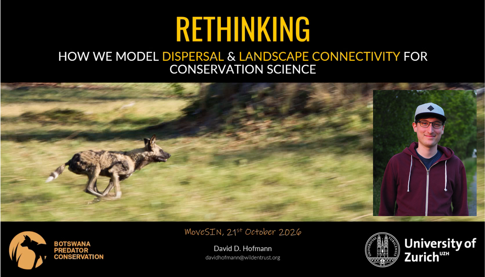

**Recording can be found here:** <https://youtu.be/uNCKO_cf1eE>

**Presentation description**\
Landscape connectivity is central to biodiversity conservation, yet traditional modelling approaches often rely on simplified assumptions about animal movement and the landscapes they inhabit. Drawing on research on African wild dog dispersal in Botswana, this talk explores how individual-based movement simulations and alternative modelling pipelines can improve connectivity predictions, and whether accounting for seasonal environmental dynamics offers additional benefits over more realistic movement models. Beyond methodological questions, the talk also challenges how we conceptualise connectivity itself, and encourages a fresh perspective on what connectivity models actually measure and how they can better inform conservation decisions.

**Papers discussed**

- Hofmann, D. D., Cozzi, G., McNutt, J. W., Ozgul, A., & Behr, D. M. (2023). **A three-step approach for assessing landscape connectivity via simulated dispersal: African wild dog case study**. *Landscape Ecology*, *38*(4), 981–998. https://doi.org/10.1007/s10980-023-01602-4

- Hofmann, D. D., Behr, D. M., McNutt, J. W., Ozgul, A., & Cozzi, G. (2024). **Dispersal and connectivity in increasingly extreme climatic conditions**. *Global Change Biology*, *30*(5), e17299. https://doi.org/10.1111/gcb.17299

- Hofmann, D. D., Behr, D. M., McNutt, J. W., Ozgul, A., & Cozzi, G. (2026). **Seasonal dynamism or model realism: What drives better predictions of landscape connectivity?** *Ecosphere*, *17*(9), e70726. https://doi.org/10.1002/ecs2.70726

**Link to David's PhD GitHub repo** <https://github.com/DavidDHofmann/PhD>

**David Hofmann**\
David started his academic journey in Economics at the University of Zurich, but eventually decided to give up the pursuit of money in favour of saving the planet. He went on to study Environmental Sciences, where his master's thesis focused on the dispersal of endangered African wild dogs in Botswana, using GPS movement data. Fascinated by these animals, their landscapes, and the potential of movement data to predict their journeys, he stayed on for a PhD in Ecology, exploring wild dog dispersal and landscape connectivity across southern Africa. Today, David is a passionate movement ecologist keen to bridge the gap between cutting-edge science and applied conservation. As Research Coordinator for Botswana Predator Conservation, he regularly finds himself overwhelmed by everything from managing field teams and databases to writing grants, fixing equipment, and navigating bureaucracy. Fortunately, the role also keeps him scientifically engaged and gives him the privilege of studying the animals he's trying to protect. When he's not drowning in emails or staring at GPS tracks, he's usually somewhere in the Botswana bush looking for some carnivores.
